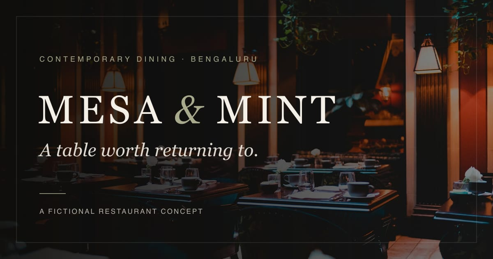

# MESA & MINT

*A table worth returning to.*

MESA & MINT is a premium restaurant and cafe website concept, built to demonstrate a refined digital experience for hospitality businesses — from independent cafes to fine-dining rooms. It pairs a dark, editorial visual identity with a fully working digital menu, a guided reservation request flow and a contact form, backed by server-side validation and an email integration that is ready to configure.

**Live demo:** [mesa-mint-restaurant-demo.vercel.app](https://mesa-mint-restaurant-demo.vercel.app/)

> [!IMPORTANT]
> MESA & MINT is a fictional restaurant created as a portfolio demonstration. It is not an operating business and does not take real bookings. See the [demo disclaimer](#demo-disclaimer).

---

## Contents

- [Preview](#preview)
- [Features](#features)
- [Technology stack](#technology-stack)
- [Pages and routes](#pages-and-routes)
- [Reservation system](#reservation-system)
- [Contact form](#contact-form)
- [Getting started](#getting-started)
- [Environment variables](#environment-variables)
- [Deployment](#deployment)
- [Project structure](#project-structure)
- [Customisation](#customisation)
- [Image attribution](#image-attribution)
- [Demo disclaimer](#demo-disclaimer)
- [Future improvements](#future-improvements)
- [License](#license)

---

## Preview

[](https://mesa-mint-restaurant-demo.vercel.app/)

The image above is the site's Open Graph share card, generated from the homepage hero photograph. Visit the [live demo](https://mesa-mint-restaurant-demo.vercel.app/) to see the full experience.

---

## Features

### Status at a glance

| Feature | Status |
| --- | --- |
| All pages, navigation, menu filtering and responsive layouts | Working |
| Reservation and contact form validation (browser and server) | Working |
| Reservation and enquiry **email delivery** | Requires configuration — **not configured on the live demo** |
| WhatsApp call to action | Requires configuration — **not configured on the live demo** |
| SEO metadata, sitemap, robots and share images | Working |

When email is not configured, both forms display a notice up front and, on submission, state clearly that the request was **not sent**. Neither form ever reports success unless the email provider confirms delivery.

### Design and experience

- Dark editorial visual design: charcoal, burgundy, olive and cream palette defined as CSS variables, Cormorant Garamond display type and Manrope body text.
- Cinematic full-screen hero with directional lighting overlays and a slow settle animation.
- Responsive header with a full-screen mobile menu (focus trap, Escape to close, scroll lock).
- Restrained scroll reveals and transitions that respect `prefers-reduced-motion`; content stays visible without JavaScript.
- Layouts designed for phones (375 px and up), tablets and desktops, with no horizontal scrolling.

### Homepage

Hero, restaurant introduction, four signature dishes (each linking to its entry on the menu), the dining experience, the restaurant's philosophy, featured dishes by course, a bar feature, a reservation call to action, and illustrative location and opening hours.

### Digital menu

- **21 illustrative dishes** across four courses: Small Plates (6), Main Course (7), Desserts (4) and Beverages (4).
- Each dish has its own photograph, a description, a price in Indian rupees (₹225–₹2,850) and dietary information.
- **Category filters** (All, Small Plates, Main Course, Desserts, Beverages) and a **vegetarian-only** switch, with the result count announced to screen readers.
- Indian-style vegetarian and non-vegetarian marks, plus labels for vegan, gluten-free, spicy, zero-proof, contains alcohol and signature dishes.
- Allergen notes for gluten, crustaceans, eggs, fish, peanuts, soy, dairy, tree nuts, celery, mustard, sesame and sulphites, where they apply.
- Vegetarian dishes are prepared without egg, following Indian convention.

### Reservations

A three-step **reservation request** flow: date, time, guests and occasion; contact details; special requests and consent. See [Reservation system](#reservation-system).

### Contact and story

- Enquiry form with typed enquiry categories, a WhatsApp card that only links when a number is configured, and a clearly labelled illustrative map.
- *Our Story* page covering philosophy, culinary approach, ingredients and sourcing, and the dining experience.
- Branded 404 page.

### SEO, performance and accessibility

- Page-specific titles, descriptions, canonical URLs, Open Graph and Twitter cards.
- `sitemap.xml`, `robots.txt` (with `/api/` disallowed) and `Restaurant` JSON-LD limited to concept information — no address, phone number or opening hours are published as structured data.
- Locally stored, pre-optimised photography served through `next/image` as AVIF or WebP, with blur placeholders and a preloaded hero image.
- All pages prerender as static HTML; only the two API routes run on demand. The animation library loads only on `/menu`.
- Security headers: `X-Content-Type-Options`, `Referrer-Policy`, `X-Frame-Options` and `Permissions-Policy`.
- Skip link, visible focus states, labelled controls and fieldsets, live-region status messages, and text contrast audited against WCAG AA.

---

## Technology stack

| Area | Technology |
| --- | --- |
| Framework | [Next.js](https://nextjs.org) 16.4 — App Router, Turbopack, Cache Components, Partial Prefetching |
| UI | React 19.3 (server components by default) |
| Language | TypeScript 5.9 |
| Styling | Tailwind CSS 4.3 with CSS-variable design tokens |
| Animation | Motion for React 14 (menu filter transitions); CSS transitions elsewhere |
| Icons | Lucide React |
| Forms and validation | React Hook Form 7 and Zod 4 via `@hookform/resolvers` — one shared schema validates in the browser and on the server |
| Email | Resend (server-side only, guarded by `server-only`) |
| Fonts | Cormorant Garamond and Manrope via `next/font/google` |
| Image tooling | sharp (development dependency) for download, grading and optimisation scripts |
| Quality | ESLint 9 with `eslint-config-next` (Core Web Vitals and TypeScript rules) |

Package manager: **npm** (`package-lock.json` is committed). Requires **Node.js 20.9 or later**.

---

## Pages and routes

| Route | Type | Description |
| --- | --- | --- |
| `/` | Page | Homepage |
| `/menu` | Page | Digital menu with filters |
| `/reservations` | Page | Reservation request form |
| `/our-story` | Page | Restaurant story and philosophy |
| `/contact` | Page | Enquiry form, WhatsApp card, illustrative map |
| `/api/reservations` | `POST` route handler | Validates and emails reservation requests |
| `/api/contact` | `POST` route handler | Validates and emails enquiries |
| `/sitemap.xml`, `/robots.txt` | Metadata routes | Generated from `src/app/sitemap.ts` and `src/app/robots.ts` |
| `/opengraph-image.jpg`, `/icon.svg`, `/apple-icon.png` | Metadata files | Share image and icons |
| Any unknown path | 404 | `src/app/not-found.tsx` |

---

## Reservation system

> [!NOTE]
> The form submits a **reservation request**, not a booking. Tables are never confirmed automatically, live availability is not shown, and there is no booking calendar. On the live demo, email delivery is **not configured**, so submitted requests are not sent anywhere and the page says so.

### What the visitor does

1. **Your visit** — choose one of the next six open days or any date in the calendar, a lunch or dinner time slot, the number of guests (1–8) and an optional occasion.
2. **Your details** — full name, email and phone.
3. **Final touches** — optional special requests (up to 500 characters) and a required consent checkbox acknowledging that this is a request.

A live summary of the request appears beside the submit button.

### Booking rules

Defined in `src/lib/reservation-rules.ts` and judged in **Asia/Kolkata** time on both the browser and the server:

| Rule | Value |
| --- | --- |
| Opening days | Tuesday – Sunday (closed Monday) |
| Lunch slots | 12:30 pm – 2:30 pm, every 30 minutes |
| Dinner slots | 7:00 pm – 10:30 pm, every 30 minutes |
| Party size | 1–8 guests (larger groups are directed to the contact form) |
| Booking window | Up to 60 days ahead; no past dates |
| Same-day notice | At least 90 minutes before the chosen slot |

Unavailable slots are disabled in the interface, and the same rules are enforced again on the server.

### How a request is processed

`POST /api/reservations` (`src/app/api/reservations/route.ts`):

1. A best-effort, per-instance rate limit: 8 requests per IP address per 10 minutes.
2. The JSON body is read with a 16 KB limit and a content-type check.
3. A hidden honeypot field (`website`) must be empty.
4. The shared Zod schema validates and sanitises every field.
5. If email is not configured, the endpoint responds `503` and the visitor is told the request was not sent.
6. Otherwise, an HTML and plain-text notification (all values HTML-escaped) is sent to `RESERVATION_TO_EMAIL`, with `reply-to` set to the guest.
7. Only after Resend confirms delivery does the visitor see:
   > Your reservation request has been received. Our team will contact you to confirm your table.

| Response | Meaning |
| --- | --- |
| `200` | Request emailed to the restaurant |
| `400` | Unreadable or oversized body, or honeypot filled |
| `422` | Validation errors, returned per field |
| `429` | Rate limit reached |
| `502` | Email provider failed; the request was **not** received |
| `503` | Email delivery not configured; the request was **not** sent |

---

## Contact form

`/contact` posts to `POST /api/contact`, which uses the same pipeline (rate limit, body limit, honeypot, Zod validation, Resend delivery and honest error states).

| Field | Rules |
| --- | --- |
| Name | Required, 2–80 characters |
| Email | Required, valid address |
| Phone | Optional; Indian or international format |
| Enquiry type | Required: General enquiry, Private dining & events, Large group (9+ guests), Dietary or accessibility question, Feedback, Press & partnerships |
| Message | Required, 20–2,000 characters |

Enquiries are sent to `CONTACT_TO_EMAIL`, or to `RESERVATION_TO_EMAIL` when that is not set.

---

## Getting started

### Prerequisites

- Node.js 20.9 or later
- npm

### Install and run

```bash
git clone https://github.com/Sohangi-Singh/mesa-mint-restaurant-demo.git
```

```bash
cd mesa-mint-restaurant-demo
```

```bash
npm install
```

```bash
cp .env.example .env.local
```

```bash
npm run dev
```

The site runs at [http://localhost:3000](http://localhost:3000). Every variable is optional for local development; without email settings the forms run in their "not configured" mode.

### Production build

```bash
npm run build
```

```bash
npm run start
```

### Scripts

| Command | Purpose |
| --- | --- |
| `npm run dev` | Start the development server |
| `npm run build` | Create a production build |
| `npm run start` | Serve the production build |
| `npm run lint` | Run ESLint |
| `npm run typecheck` | Run the TypeScript compiler without emitting files |
| `npm run images` | Download and optimise photography from `scripts/image-manifest.json` (`-- --force` re-encodes from the local cache, `-- --refetch` re-downloads) |
| `npm run brand-assets` | Regenerate `src/app/opengraph-image.jpg` and `src/app/apple-icon.png` |

The optimised images are committed in `src/assets/images`, so `npm run images` is only needed when changing the photography.

---

## Environment variables

Copy `.env.example` to `.env.local` for local development. **Never commit `.env.local`** — it is excluded by `.gitignore`. No real credentials are stored in this repository.

| Variable | Required | Scope | Purpose | Live demo |
| --- | --- | --- | --- | --- |
| `NEXT_PUBLIC_SITE_URL` | Recommended | Public | Canonical origin for metadata, sitemap and JSON-LD. Falls back to Vercel's production domain (`VERCEL_PROJECT_PRODUCTION_URL`), then `http://localhost:3000`. | Resolves to the live domain |
| `RESEND_API_KEY` | For email | Server only | Resend API key | Not configured |
| `RESERVATION_FROM_EMAIL` | For email | Server only | Sender on a Resend-verified domain, e.g. `MESA & MINT <reservations@your-domain.com>` | Not configured |
| `RESERVATION_TO_EMAIL` | For email | Server only | Inbox that receives reservation requests | Not configured |
| `CONTACT_TO_EMAIL` | Optional | Server only | Inbox for enquiries; defaults to `RESERVATION_TO_EMAIL` | Not configured |
| `NEXT_PUBLIC_WHATSAPP_NUMBER` | Optional | Public | Digits only with country code, e.g. `919876543210`. When unset or implausible, a "not yet available" card is shown instead of a link. | Not configured |

Email delivery switches on only when `RESEND_API_KEY`, `RESERVATION_FROM_EMAIL` and `RESERVATION_TO_EMAIL` are all present. Because pages are prerendered, the configuration notices on the forms reflect the environment **at build time** — redeploy after changing variables. The API routes always read the current environment.

### Configuring Resend

1. Create an account at [resend.com](https://resend.com) and generate an API key.
2. Verify a sending domain. For testing only, the sandbox sender `onboarding@resend.dev` can deliver to the email address registered on your Resend account.
3. Set the three email variables (and optionally `CONTACT_TO_EMAIL`), then restart the dev server or redeploy.

---

## Deployment

The live demo is deployed on Vercel at **[mesa-mint-restaurant-demo.vercel.app](https://mesa-mint-restaurant-demo.vercel.app/)**.

To deploy your own copy:

1. Push the repository to GitHub, GitLab or Bitbucket.
2. In Vercel, choose **Add New → Project** and import the repository. The detected Next.js settings need no changes.
3. Optionally add the [environment variables](#environment-variables) under **Settings → Environment Variables**, then redeploy.
4. Optionally add a custom domain and set `NEXT_PUBLIC_SITE_URL` to it.

The built-in rate limiter keeps its counters in memory, so on serverless hosting each instance counts separately. Use a shared store such as Upstash Redis if strict limits are required.

---

## Project structure

```text
src/
  app/                    Routes, metadata files and API route handlers
    api/reservations/     Reservation request endpoint
    api/contact/          Contact enquiry endpoint
    menu/  reservations/  our-story/  contact/
    layout.tsx            Fonts, metadata, header and footer
    template.tsx          Route fade transition
    not-found.tsx         404 page
    sitemap.ts  robots.ts
  assets/images/          Optimised photography
  components/
    home/                 Homepage sections
    menu/                 Menu filters and dish rows
    forms/                Form controls, reservation and contact forms
    contact/              WhatsApp card and illustrative map
    sections/             Shared sections (reservation CTA, hours, location)
    layout/               Header, footer, wordmark
    ui/                   Buttons, headings, reveals, diet marks, notices
  data/                   Restaurant content: site.ts, menu.ts, images.ts
  lib/                    Validation, reservation rules, email, formatting, metadata
scripts/
  image-manifest.json     Photo sources, credits and grading options
  fetch-images.mjs        Download, grade and optimise photography
  generate-brand-assets.mjs
```

---

## Customisation

The project is structured so it can be adapted for a real restaurant without touching component code.

| To change | Edit |
| --- | --- |
| Name, tagline, description, cuisine, disclaimer, navigation, hours, placeholder contacts | `src/data/site.ts` |
| Menu items, categories, prices, diets, allergens, signature and featured dishes | `src/data/menu.ts` |
| Photography, alt text and crop focal points | `scripts/image-manifest.json` → `npm run images` → `src/data/images.ts` |
| Colours, type scale and animation | `src/app/globals.css` |
| Fonts | `src/app/layout.tsx` |
| Time slots, closed days, party size, booking window, same-day notice | `src/lib/reservation-rules.ts` |
| Form fields and validation messages | `src/lib/validation/` and `src/components/forms/` |
| Notification email layout | `src/lib/email.ts` |
| Structured data | `RestaurantJsonLd` in `src/app/page.tsx` |

For a real venue, also remove the concept disclaimers, replace the placeholder contact details and social labels, replace the illustrative map, verify allergen and pricing information with the kitchen, and only add `address`, `telephone` or opening hours to the structured data once they are confirmed.

---

## Image attribution

All photography comes from [Unsplash](https://unsplash.com) and is used under the [Unsplash License](https://unsplash.com/license). Only images marked *Free* were used; none are from Unsplash+. Credit is given below with thanks.

Each dish photograph represents exactly one menu item; dishes were named and described to match their photographs. Food and drink images receive a shared, subtle colour grade in `scripts/fetch-images.mjs` so that work by different photographers reads as one set. The photographs show real dishes and spaces by the credited photographers — not MESA & MINT, which does not exist. People appear only incidentally (hands, partial or distant figures) and are not presented as staff or guests.

<details>
<summary>Photographer credits (40 images)</summary>

| File | Photographer | Source |
| --- | --- | --- |
| `interior-pendant-lights.jpg` | Takahiro Taguchi | [unsplash.com/photos/lighted-lamps-in-room-8l_RuuZrOyY](https://unsplash.com/photos/lighted-lamps-in-room-8l_RuuZrOyY) |
| `table-low-light.jpg` | Alexandr Popadin | [unsplash.com/photos/a-dimly-lit-restaurant-table-setting-with-place-settings-DtfzqdgC7AQ](https://unsplash.com/photos/a-dimly-lit-restaurant-table-setting-with-place-settings-DtfzqdgC7AQ) |
| `table-lamp-glasses.jpg` | Jivan Garcha | [unsplash.com/photos/two-empty-wine-glasses-on-a-table-in-a-restaurant-Eq82Au8Gwrc](https://unsplash.com/photos/two-empty-wine-glasses-on-a-table-in-a-restaurant-Eq82Au8Gwrc) |
| `dining-room-hanging-lights.jpg` | Eirc Shi | [unsplash.com/photos/modern-restaurant-interior-with-hanging-lights-knvnCoc5qH4](https://unsplash.com/photos/modern-restaurant-interior-with-hanging-lights-knvnCoc5qH4) |
| `chef-garnish-greens.jpg` | Alfonso Betancourt | [unsplash.com/photos/chef-garnishing-a-small-dish-with-fresh-greens-Bq44jpoeFf4](https://unsplash.com/photos/chef-garnishing-a-small-dish-with-fresh-greens-Bq44jpoeFf4) |
| `wine-and-plate-low-light.jpg` | Tommaso Ubezio | [unsplash.com/photos/elegant-plate-of-food-with-a-glass-of-wine-Upz2cj1Y-qM](https://unsplash.com/photos/elegant-plate-of-food-with-a-glass-of-wine-Upz2cj1Y-qM) |
| `dimly-lit-dining-room.jpg` | Oliver Guhr | [unsplash.com/photos/a-dimly-lit-restaurant-with-tables-and-chairs-EjHiN2KxTO4](https://unsplash.com/photos/a-dimly-lit-restaurant-with-tables-and-chairs-EjHiN2KxTO4) |
| `amber-lights-dining-room.jpg` | Dmitry Spravko | [unsplash.com/photos/a-restaurant-with-a-bunch-of-lights-hanging-from-the-ceiling-wrW1mQTja7w](https://unsplash.com/photos/a-restaurant-with-a-bunch-of-lights-hanging-from-the-ceiling-wrW1mQTja7w) |
| `sauce-pour.jpg` | Urban Gyllström | [unsplash.com/photos/chef-pouring-sauce-over-plated-steak-MaWMfm-HCqQ](https://unsplash.com/photos/chef-pouring-sauce-over-plated-steak-MaWMfm-HCqQ) |
| `chef-tweezers-herbs.jpg` | Alfonso Betancourt | [unsplash.com/photos/chef-meticulously-garnishes-a-gourmet-dish-with-fresh-herbs-u3OOrE2jeHg](https://unsplash.com/photos/chef-meticulously-garnishes-a-gourmet-dish-with-fresh-herbs-u3OOrE2jeHg) |
| `spices-curry-leaves.jpg` | Anju Ravindranath | [unsplash.com/photos/a-table-topped-with-different-types-of-spices-Nihdo084Yos](https://unsplash.com/photos/a-table-topped-with-different-types-of-spices-Nihdo084Yos) |
| `fresh-mint.jpg` | Simon Lee | [unsplash.com/photos/green-mint-leaves-texture-bHWRSq8fUUE](https://unsplash.com/photos/green-mint-leaves-texture-bHWRSq8fUUE) |
| `white-linen-dining.jpg` | Tanja Tepavac | [unsplash.com/photos/elegant-dining-tables-set-in-a-cozy-restaurant-interior-jSH-7IjJVsQ](https://unsplash.com/photos/elegant-dining-tables-set-in-a-cozy-restaurant-interior-jSH-7IjJVsQ) |
| `shared-table-wine.jpg` | Kamilla Isalieva | [unsplash.com/photos/a-table-is-set-with-wine-glasses-and-plates-of-food-JDjarj_oSyo](https://unsplash.com/photos/a-table-is-set-with-wine-glasses-and-plates-of-food-JDjarj_oSyo) |
| `table-glasses-linen.jpg` | Julie Mallet | [unsplash.com/photos/restaurant-table-set-with-wine-glasses-and-cutlery-qKfSyHj1Y20](https://unsplash.com/photos/restaurant-table-set-with-wine-glasses-and-cutlery-qKfSyHj1Y20) |
| `round-table-alcove.jpg` | Decima Athens | [unsplash.com/photos/a-restaurant-with-a-round-table-and-chairs-PisnUZWdsms](https://unsplash.com/photos/a-restaurant-with-a-round-table-and-chairs-PisnUZWdsms) |
| `empty-dining-room.jpg` | Justin Smith | [unsplash.com/photos/a-dimly-lit-room-with-tables-and-chairs-Mxy87tWuMVE](https://unsplash.com/photos/a-dimly-lit-room-with-tables-and-chairs-Mxy87tWuMVE) |
| `bartender-pour.jpg` | Hybrid Storytellers | [unsplash.com/photos/bartender-pouring-amber-liquid-into-a-glass-with-ice-x07Im_cq6tY](https://unsplash.com/photos/bartender-pouring-amber-liquid-into-a-glass-with-ice-x07Im_cq6tY) |
| `cocktail-trio.jpg` | Mediha Ekici | [unsplash.com/photos/three-colorful-cocktails-arranged-on-a-dark-reflective-surface-RQIq-yBMPAA](https://unsplash.com/photos/three-colorful-cocktails-arranged-on-a-dark-reflective-surface-RQIq-yBMPAA) |
| `dish-burrata.jpg` | Pinar Kucuk | [unsplash.com/photos/cooked-food-on-brown-plate-rq0GMrnLj8c](https://unsplash.com/photos/cooked-food-on-brown-plate-rq0GMrnLj8c) |
| `dish-kingfish-crudo.jpg` | Harrison Chang | [unsplash.com/photos/fish-appetizer-with-green-topping-and-oil-dAUQZiUMGW0](https://unsplash.com/photos/fish-appetizer-with-green-topping-and-oil-dAUQZiUMGW0) |
| `dish-tiger-prawns.jpg` | Vino Li | [unsplash.com/photos/cooked-shrimp-with-sliced-of-lime-and-basil-TqOEGdRNowY](https://unsplash.com/photos/cooked-shrimp-with-sliced-of-lime-and-basil-TqOEGdRNowY) |
| `dish-heirloom-carrots.jpg` | Adam Jaime | [unsplash.com/photos/vegetable-dish-on-white-plate-oFljzK61O1s](https://unsplash.com/photos/vegetable-dish-on-white-plate-oFljzK61O1s) |
| `dish-beetroot-tartare.jpg` | Anto Meneghini | [unsplash.com/photos/a-small-white-bowl-filled-with-food-on-top-of-a-wooden-tray-HDa6FZBsOEg](https://unsplash.com/photos/a-small-white-bowl-filled-with-food-on-top-of-a-wooden-tray-HDa6FZBsOEg) |
| `dish-tandoor-paneer.jpg` | Viktor Forgacs | [unsplash.com/photos/cooked-foods-WmKXu-bzygo](https://unsplash.com/photos/cooked-foods-WmKXu-bzygo) |
| `dish-lamb-chops.jpg` | Jonathan Borba | [unsplash.com/photos/a-wooden-plate-topped-with-meat-next-to-a-bowl-of-sauce-pJ5LO8OWDF8](https://unsplash.com/photos/a-wooden-plate-topped-with-meat-next-to-a-bowl-of-sauce-pJ5LO8OWDF8) |
| `dish-lobster-morels.jpg` | Trình Minh Thư | [unsplash.com/photos/cooked-food-on-black-round-plate-a6kYPun9_ao](https://unsplash.com/photos/cooked-food-on-black-round-plate-a6kYPun9_ao) |
| `dish-seabass.jpg` | Jessica Hearn | [unsplash.com/photos/a-plate-of-food-2LXuRH4JCEM](https://unsplash.com/photos/a-plate-of-food-2LXuRH4JCEM) |
| `dish-ghee-roast-chicken.jpg` | Nathan Dumlao | [unsplash.com/photos/cooked-meat-on-white-ceramic-plate-Xt4yZUIpRTo](https://unsplash.com/photos/cooked-meat-on-white-ceramic-plate-Xt4yZUIpRTo) |
| `dish-tagliatelle.jpg` | Jean-claude Attipoe | [unsplash.com/photos/pasta-dish-on-black-ceramic-plate--sbE6MDlEuM](https://unsplash.com/photos/pasta-dish-on-black-ceramic-plate--sbE6MDlEuM) |
| `dish-roast-cauliflower.jpg` | Alexandra Tran | [unsplash.com/photos/brown-and-white-food-on-blue-ceramic-plate-zv9UJYF209M](https://unsplash.com/photos/brown-and-white-food-on-blue-ceramic-plate-zv9UJYF209M) |
| `dish-mushroom-risotto.jpg` | Max Griss | [unsplash.com/photos/cooked-rice-with-green-vegetable-on-white-round-plate-D9fAmtjC284](https://unsplash.com/photos/cooked-rice-with-green-vegetable-on-white-round-plate-D9fAmtjC284) |
| `dish-poached-pear.jpg` | Madeline Liu | [unsplash.com/photos/gourmet-dessert-with-caramel-sauce-and-edible-flowers-gvar4yxpBWk](https://unsplash.com/photos/gourmet-dessert-with-caramel-sauce-and-edible-flowers-gvar4yxpBWk) |
| `dish-chocolate-tart.jpg` | Razvan Mirel | [unsplash.com/photos/brown-cake-on-white-ceramic-plate-ufK6dVE4KHA](https://unsplash.com/photos/brown-cake-on-white-ceramic-plate-ufK6dVE4KHA) |
| `dish-coffee-tiramisu.jpg` | Taylor Heery | [unsplash.com/photos/a-piece-of-cake-sitting-on-top-of-a-white-plate-_Bs62oh7x5Q](https://unsplash.com/photos/a-piece-of-cake-sitting-on-top-of-a-white-plate-_Bs62oh7x5Q) |
| `dish-rose-panna-cotta.jpg` | Mantra Media | [unsplash.com/photos/desert-with-red-berries-on-plate-W7b8Sqb7PG8](https://unsplash.com/photos/desert-with-red-berries-on-plate-W7b8Sqb7PG8) |
| `drink-mint-cooler.jpg` | Paige Ledford | [unsplash.com/photos/clear-drinking-glass-with-pink-liquid-and-lemon-1Di03LTniYE](https://unsplash.com/photos/clear-drinking-glass-with-pink-liquid-and-lemon-1Di03LTniYE) |
| `drink-passionfruit-sour.jpg` | Natalia Marcelewicz | [unsplash.com/photos/a-couple-of-glasses-that-are-sitting-on-a-table-IKFEtXukVy8](https://unsplash.com/photos/a-couple-of-glasses-that-are-sitting-on-a-table-IKFEtXukVy8) |
| `drink-jaggery-old-fashioned.jpg` | Milan Trninic | [unsplash.com/photos/cocktail-with-orange-peel-on-a-bar-counter-IHvtgDaeJvo](https://unsplash.com/photos/cocktail-with-orange-peel-on-a-bar-counter-IHvtgDaeJvo) |
| `drink-masala-chai.jpg` | Amir Shrestha | [unsplash.com/photos/a-glass-of-liquid-on-a-table-Ke0BiErDX_Y](https://unsplash.com/photos/a-glass-of-liquid-on-a-table-Ke0BiErDX_Y) |

</details>

---

## Demo disclaimer

MESA & MINT is a **fictional restaurant concept** created as a web development portfolio demonstration.

- All menu items, prices, business details, opening hours and restaurant information are illustrative and do not represent an operating restaurant.
- No address, phone number, email inbox or social media account exists. Contact details use a reserved `.example` domain and a zeroed phone number, and are labelled as placeholders.
- The reservation form must not be represented as a live booking service. On the live demo, requests are not delivered, and no request is ever confirmed automatically.
- Allergen information is illustrative and must not be relied upon.

---

## Future improvements

These are possible extensions. **None of them are implemented.**

- Live reservation management with staff confirmation workflows
- Restaurant administration dashboard
- Automated confirmation emails to guests
- Table availability and capacity management
- Online ordering for takeaway or delivery
- Payment integration for deposits or orders
- CMS-based menu and content management
- Shared-store rate limiting for serverless deployments

---

## License

No explicit license has been provided for this project's source code. Unless a license is added, all rights are reserved by the author.

The photography is licensed separately under the [Unsplash License](https://unsplash.com/license) by its respective photographers, as credited above.
